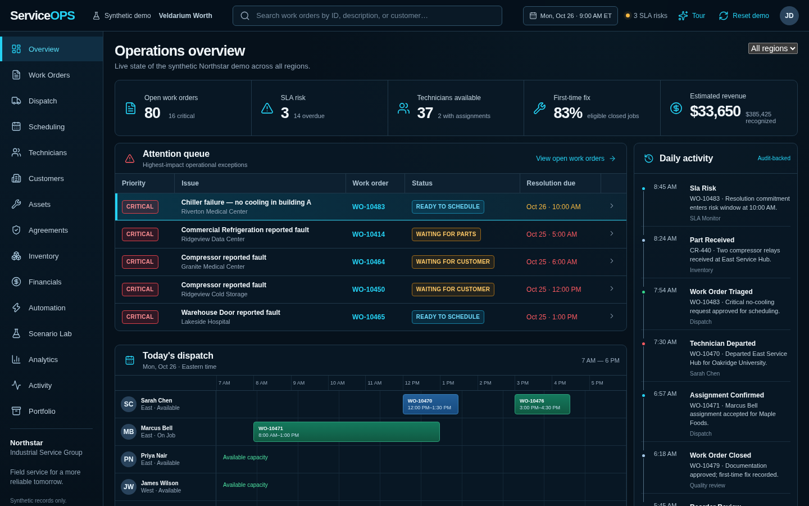

# ServiceOPS

ServiceOPS is a local-first field-service intelligence, dispatch, and operational-control demonstration for the fictional **Northstar Industrial Service Group**. It demonstrates real state transitions, technician constraints, parts reservation, SLA risk, service economics, audit history, and reversible operational scenarios—without accounts, a database, or paid APIs.

> All people, companies, sites, assets, jobs, and financial records in the application are synthetic.

## Live demo

[Open ServiceOPS](https://serviceops-phi.vercel.app) — canonical public synthetic demonstration; no account or backend configuration required.

[Return to Veldarium Worth](https://veldariumworth.com/) for the broader portfolio.



## What you can do

| Area | Capability |
| --- | --- |
| Work orders | Create (Zod-validated intake, SLA from the customer's agreement), triage, approve, assign with an explainable recommendation, reserve parts, complete with a validated record, close, cancel, invoice |
| Scheduling | Batch-schedule the ready queue with a deterministic greedy heuristic; compare against a naive first-available baseline; runtime measured in the browser; accept explicitly |
| Agreements | Platinum/Gold/Standard tiers on 24×7, extended, and standard business calendars (holidays included); contract SLA computed in business minutes |
| Financials | Invoices from recorded labor/parts/travel, partial and full payments; invoiced revenue and cash received reported separately (integer cents) |
| Automation | Three threshold rules (invoice, reorder review, SLA escalation): propose → preview → approve/decline → receipt; idempotent, stale-trigger checked |
| Scenario Lab | Six disruptions on an isolated copy of state, each with a recovery proposal; reset restores canonical state |
| Entities | Technicians, customers, assets (PM overdue warnings, service history), inventory (filters, reservations), audit (type filter, search) |
| Persistence | Browser localStorage, schema v2 with v1 migration, strict validation; tampered state is rejected with a notice |

## Demonstration boundary

| Boundary | What it means |
| --- | --- |
| Functional | Lifecycle guards, scheduling constraints, reservations, SLA calculations, invoices, partial payments, approval receipts, audit events, and reset recovery execute against shared in-browser state. |
| Synthetic | Northstar, its people and records, the demo clock, disruption scenarios, and recommendations are deterministic fictional data. |
| Not connected | Authentication, multi-user coordination, production databases, ERP/CRM feeds, notifications, telemetry, and provider-backed optimization are outside this public demonstration. |

Heuristics are labeled as heuristics. Nothing in the app is machine learning or a proven optimum.

## Local development

```bash
npm ci
npm run dev
```

Open `http://localhost:3000`. Run `npm run verify` for lint, type checking, unit tests, and the production build; run `npm run test:e2e` for the desktop/mobile browser suite with its verified 60-second per-test budget. `node scripts/capture-portfolio.mjs` (with the dev server running) regenerates the screenshots in `public/portfolio/`.

The public root is the only indexable application page. It publishes canonical, Open Graph, Twitter, robots, sitemap, manifest, favicon, and `SoftwareApplication` structured metadata using `https://serviceops-phi.vercel.app` as the single canonical URL.

## Architecture and status

- [Architecture decision](docs/architecture/ADR-001-platform.md)
- [Repository audit and continuation decision](docs/architecture/ADR-002-incremental-continuation.md)
- [Product requirements](docs/product/requirements.md)
- [Data dictionary](docs/data-dictionary.md)
- [Testing strategy](docs/testing.md)
- [Deployment guide](docs/deployment.md)

The initial release is a portfolio-grade vertical slice, not a claim of production enterprise readiness or real customer adoption. No license has been added because the owner has not selected one.
